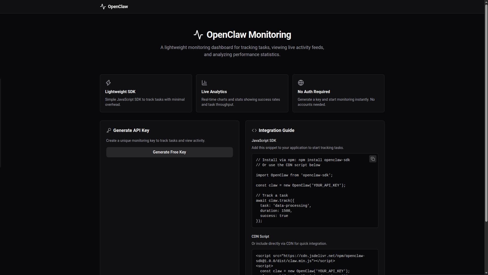

# OpenClaw Monitoring Dashboard

A no-auth monitoring dashboard that lets users generate a unique API key, track tasks via a lightweight SDK, and view live activity feeds and statistics. The key is used client-side to send events to the backend, which aggregates and renders real-time dashboards.

---

## ✨ Features

- One-click API key generation with a copy button.
- Random key format: `claw_abc123def456`.
- Track endpoint (`POST /api/track`) for task duration, success flag, and timestamp.
- Live activity feed in the dashboard (real-time events via polling).
- Simple charts: success rate, tasks per hour.
- Stats cards: total tasks, overall success rate.
- Integration guide with copy-paste JavaScript SDK snippet.
- Mobile-responsive UI layout.
- Real-time updates (polling/SSE).

---



## 🛠️ Tech Stack

**Backend**
- Flask (web framework)
- Flask-SQLAlchemy (ORM)
- python-dotenv (environment variables)
- SQLite (database)

**Frontend**
- React (library)
- Vite (build tool)
- Chart.js (charting)
- Axios (HTTP client) – *or native `fetch` as shown in spec*

**Other**
- Node.js >=18
- Python >=3.10

---

## 🚀 How to Run Locally

### Prerequisites
- **Node.js** >= 18 and npm (or yarn).
- **Python** >= 3.10 and pip.

### 1. Clone the Repository
```bash
git clone <repo-url>
cd openclaw-monitoring
```

### 2. Backend Setup
```bash
cd backend
python -m venv venv
source venv/bin/activate   # On Windows: venv\Scripts\activate
pip install -r requirements.txt
```

Create or edit the `.env` file in the project root (or inside `backend/`):
```
DATABASE_URL=sqlite:///instance/openclaw.db
```

Ensure the `instance/` folder exists (for SQLite files):
```bash
mkdir -p instance
```

Initialize the database (tables are created automatically on first run, but you can also run migrations if using Flask-Migrate):
```bash
python app.py
```
The backend will start on **port 3000**.

### 3. Frontend Setup
```bash
cd frontend
npm install
```

Create a `vite.config.js` file in `frontend/` to proxy API requests to the backend during development:
```javascript
import { defineConfig } from 'vite'
import react from '@vitejs/plugin-react'

export default defineConfig({
  plugins: [react()],
  server: {
    proxy: {
      '/api': 'http://localhost:5000'
    }
  }
})
```

Start the frontend:
```bash
npm run dev
```
The frontend will run on **port 5173** (Vite default). API calls from the frontend will be proxied to the backend at `http://localhost:5000/api/...`.

### 4. Access the App
Open your browser and go to `http://localhost:5173`.

---

## 📡 API Endpoints

### `POST /api/keys`
Generate a new monitoring key.
- **Request:** none
- **Response:** `{ "key": "claw_abc123def456" }`

### `POST /api/track`
Record a monitoring event.
- **Request body:** `{ "key": "claw_...", "task": "string", "duration": 123, "success": true, "timestamp": "2025-01-01T00:00:00Z" }`
- **Response:** `{ "id": 1, "key": "claw_...", "task": "...", "duration": 123, "success": true, "timestamp": "..." }`

### `GET /api/dashboard/:key`
Retrieve recent events and aggregated stats for a key.
- **Response:** `{ "recent_events": [...], "stats": { "total_tasks": 10, "success_rate": 80.0, "tasks_per_hour": 2.5 } }`

---

## 📖 Integration Guide (Client-Side SDK)

Once you have generated an API key, you can track events with the following copy-paste JavaScript snippet:

```javascript
// Replace with your generated key
const API_KEY = 'claw_your_key_here';

async function trackEvent(task, duration, success = true) {
  const response = await fetch('/api/track', {
    method: 'POST',
    headers: { 'Content-Type': 'application/json' },
    body: JSON.stringify({
      key: API_KEY,
      task,
      duration,
      success,
      timestamp: new Date().toISOString()
    })
  });
  return await response.json();
}

// Example usage:
trackEvent('data-sync', 250, true);
```

---

## 📂 Project Structure
```
openclaw-monitoring/
├── backend/
│   ├── app.py
│   ├── config.py
│   ├── models.py
│   ├── requirements.txt
│   └── .env
├── frontend/
│   ├── index.html
│   ├── package.json
│   ├── vite.config.js
│   └── src/
│       ├── main.jsx
│       ├── App.jsx
│       ├── components/
│       │   ├── Dashboard.jsx
│       │   ├── Home.jsx
│       │   ├── KeyGenerator.jsx
│       │   └── IntegrationGuide.jsx
│       ├── services/
│       │   └── api.js
│       └── utils/
│           └── format.js
├── migrations/
│   └── __init__.py
├── .gitignore
└── README.md
```

---

## 🤝 Contributing

Contributions are welcome! Please open an issue or submit a pull request.

---

## 📄 License

This project is licensed under the [MIT License](/LICENSE).